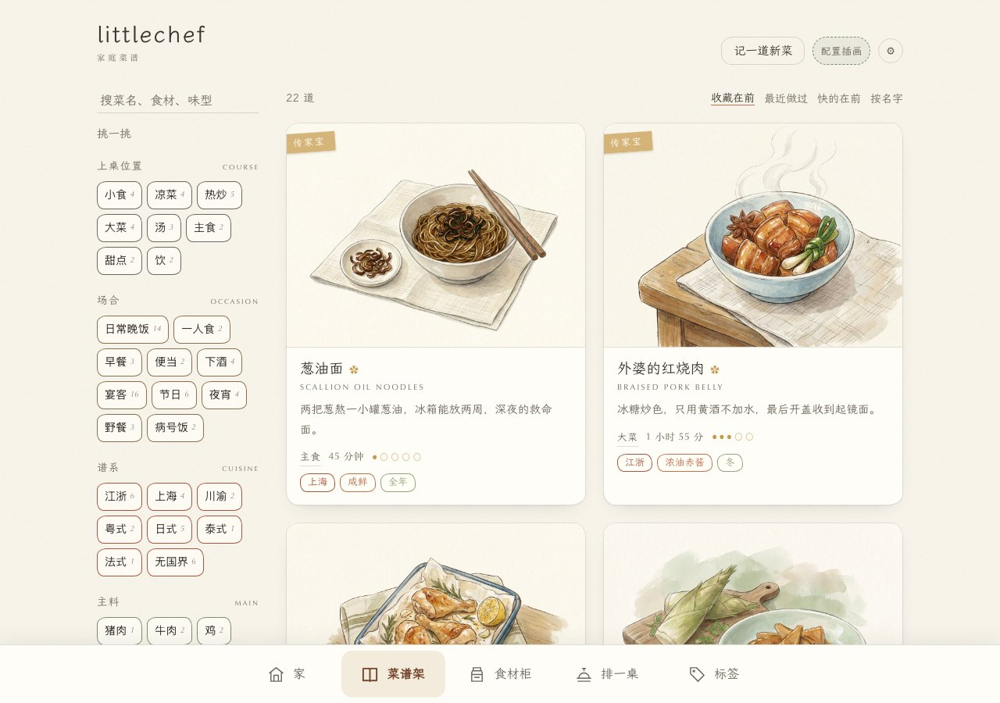
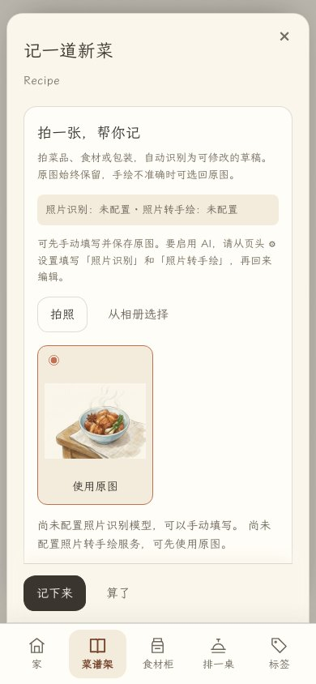
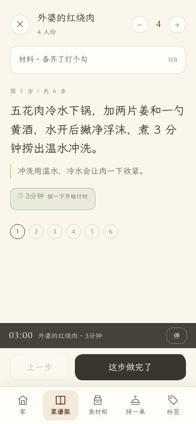
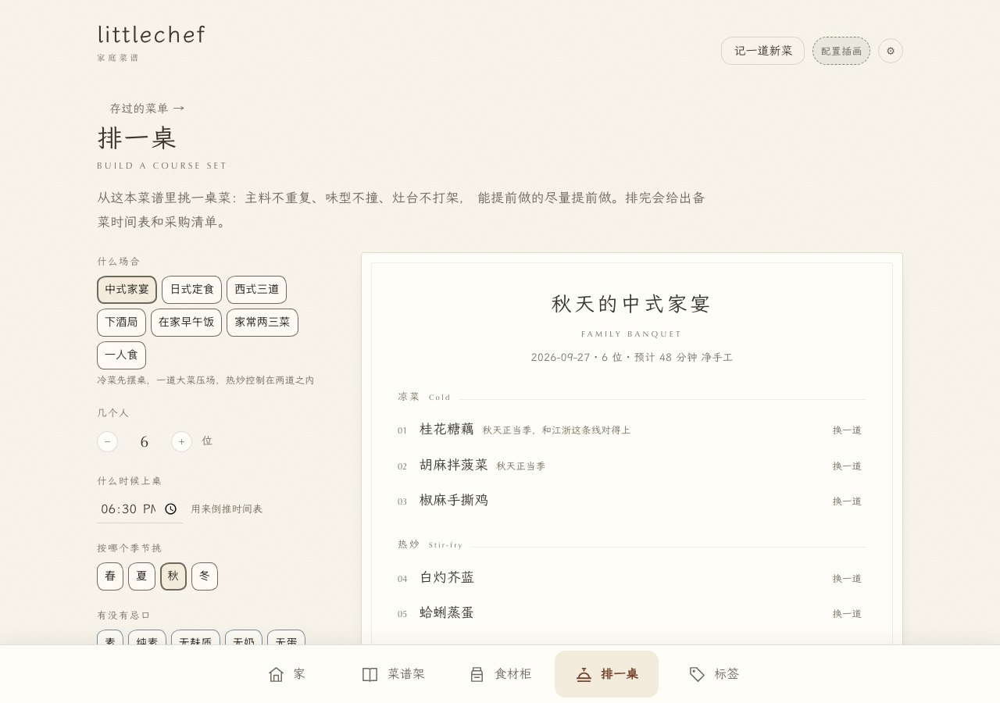
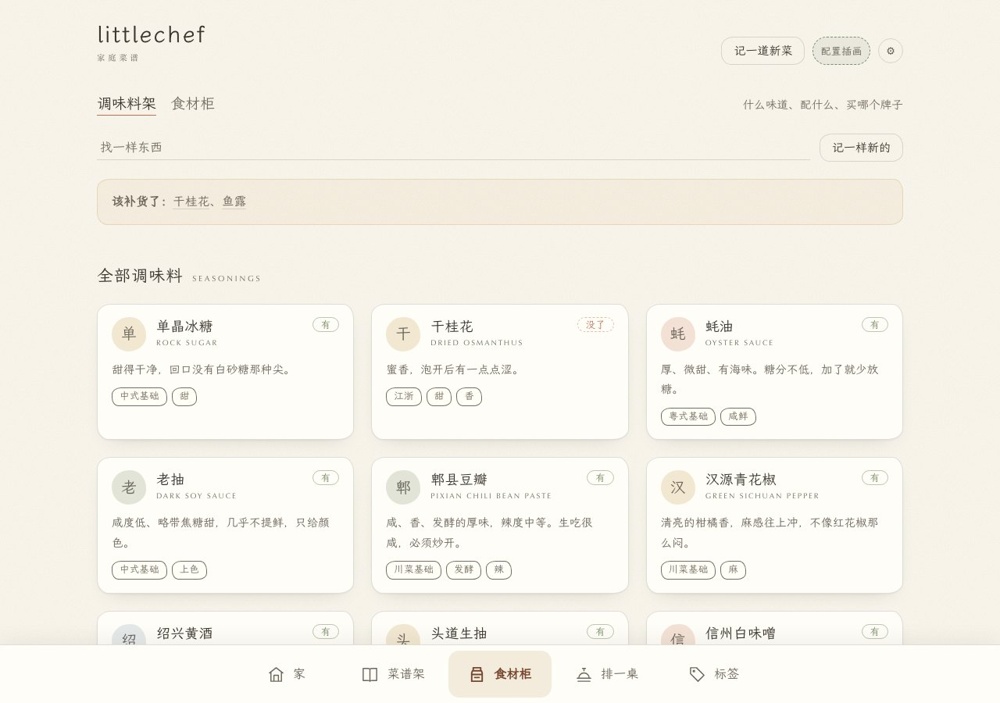

# littlechef

版本 **1.0.0-rc.2** · 源码候选版 · [交付与验收说明](docs/release.md)

**把菜谱、食材、下厨记录和一桌菜单，放进一本自己保存的家庭菜谱。**

运行在电脑或 NAS 上，手机浏览器即可使用。无需 AI 也能记菜、拍照、计时和排菜单；AI 识别与手绘是可选功能。

| 想做什么 | 从哪里开始 | 得到什么 |
| --- | --- | --- |
| 记一道菜 | **菜谱架 → 记一道新菜** | 照片、材料、做法和试做记录 |
| 整理家里的食材 | **食材柜 → 记一样新的** | 库存状态、挑选与保存笔记 |
| 跟着步骤做饭 | **菜谱详情 → 下厨模式** | 大字步骤、备料勾选、多个计时器 |
| 招待一桌客人 | **排一桌 → 选择人数与忌口** | 菜单、备菜时间表、采购清单 |

底部五个入口始终可见。切换页面时会提醒未保存的修改；退出下厨模式后计时器继续运行，**刷新或关闭页面会清除计时器**。



## 先运行起来

在项目目录执行以下一种方式。

### Docker / NAS

```bash
cp .env.example .env
docker compose up -d --build
```

打开 **`http://电脑或NAS的IP:8848`**。本机可用 [localhost:8848](http://localhost:8848)。需要支持 `env_file.required` 的 Docker Compose 版本。

### 本地 Python

安装 Python 3.11+ 后运行：

```bash
./run.sh
```

脚本会创建 `.venv`、安装依赖并启动服务。首次安装需要网络。首次使用新数据目录会加入 **22 道菜、22 样食材与调味料、2 份菜单、26 张插画**；之后不会因删空菜谱而重新加入示例。

## 三条常用流程

### 1. 拍照记菜 / 记食材

**新建 → 拍照或选图 → 核对信息 → 选择原图或手绘 → 保存。**

- 没配 AI：照片照常保存，信息自己填。
- 配好 AI：自动识别到草稿，再参考照片生成手绘候选图；看不出的用量和做法需要自己补。
- 原图默认选中，手绘不准确就保留原图。已生成的两张图都会保存，之后编辑时还能切换。
- 已有记录的非空字段和正在手动修改的内容不会被 AI 覆盖。识别失败可以重试，也可以继续手填。



*截图为实际录入界面，上传的是项目内置示例插画；未调用 AI，不代表照片识别或手绘生成效果。手机的拍照/相册选项由系统与浏览器提供。*

只填名称也能保存，其他信息可随后补充。材料一行一种，例如 `五花肉 600g 切块`；步骤一行一步，提示可写成 `小火焖 20 分钟 || 中途看水量`。

### 2. 找到菜 → 开始做 → 记下这次体验

在菜谱架搜索菜名或食材，打开详情，调整人数后用量会跟着折算。进入「下厨模式」后逐步操作，点击时间标记启动计时；完成后「记一笔」，只想记录日期则点「做了一次」。



### 3. 选人数和条件 → 排菜单 → 保存或打印

「排一桌」中选择模板、人数、季节、忌口和可用灶位。结果含菜品、缺位提醒、备菜时间表和采购清单；可换一道或整套重排。修改条件后需重新生成，避免保存旧结果。

忌口筛选依赖自己维护的菜谱标签；时间表和搭配建议需要结合实际厨房安排确认。保存后从「存过的菜单」查看，也可用浏览器打印为 PDF。



## 食材柜：知道家里有什么

「调味料架」和「食材柜」分开查看，支持搜索、新建、拍照及记录品牌、保存方式和替代品。点「有 / 没了」更新库存；缺货项目集中提醒。



## AI 怎么配置？

打开页头 **⚙ 设置**。三类功能分别配置，**不必全部开启**：

| 功能 | 设置分组 | 服务需要支持 |
| --- | --- | --- |
| 照片自动填表 | 照片识别 | 支持图片输入的 `POST /chat/completions` |
| 原照片转手绘 | 照片转手绘 | 接受原图的 `POST /images/edits` |
| 按菜名生成插画 | 出图模型 | 已集成的 Ark / OpenAI 兼容接口 / SD WebUI |

照片识别需填写**服务地址、视觉模型 ID、API Key**；照片转手绘需填写对应的**图像编辑模型**与服务地址。照片两项密钥留空时会复用 OpenAI API Key；使用其他服务请填写各自的密钥。保存后立即生效。

- **文生图模型不等于图片编辑模型**，只支持生成插画的服务不能保证支持照片转手绘。
- 照片会发送到配置的服务。照片副本会缩小并移除 EXIF，不替代手机原文件备份。
- 模型可能识别错误；用量、做法、品牌和过敏原需自己确认。
- 点击停止会停止等待；已经发出的服务请求可能继续执行并产生费用。
- 真实模型质量取决于服务、模型与照片；仓库测试使用模拟响应，不能证明识别准确度或手绘还原度。

## 数据放在哪里？怎么备份？

**服务版的数据在 `data/`，完整备份就是复制这个目录。** 包括菜谱、食材、菜单、照片、设置及回收内容。建议先停止服务再复制；恢复时也先停止服务。

**静态分享版的数据在各自浏览器里，不会自动同步回 NAS。** 页头「本机草稿」可导出带照片的 JSON；换设备或清理浏览器前先导出。

| 方式 | 包含 | 用途 |
| --- | --- | --- |
| 复制 `data/` | 全部数据，含密钥设置与回收内容 | 完整备份 / 换机器 |
| `GET /api/export` | 菜谱、食材、菜单、标签、图片；不含密钥设置 | 数据快照 |
| 本机草稿 → 导出成文件 | 本机改动及照片，并附完整菜谱内容 | 带回 NAS 合并 |

静态分享、导入合并、离线字体和 API 用法见 [维护与开发指南](docs/operations.md)。

## 遇到问题先看这里

| 现象 | 下一步 |
| --- | --- |
| 打不开页面 | 确认服务已启动、地址和端口正确，手机与 NAS 网络可达 |
| 拍照后没有识别 | 看表单的配置状态；到 ⚙ 设置填写视觉模型，或先手填保存 |
| 能识别，不能转手绘 | 检查编辑服务是否支持 `/images/edits`，原图仍可使用 |
| 保存需要 PIN / 不能编辑 | 输入编辑口令；只读状态可在设置中关闭 |
| 手绘不像 / 信息不准 | 选「使用原图」，手动修正字段后保存 |
| 静态版换设备后没记录 | 本机草稿不跨设备同步；在原设备导出，再导入到新设备 |

**部署边界：**编辑 PIN 仅用于限制写入，不保护读取。不要把未加鉴权的服务直接开放到公网；外部访问需自行配置 HTTPS 与真正的访问控制。

## 项目与检查

纯 HTML/CSS/JavaScript 前端，无构建步骤；FastAPI 后端，JSON 文件存储。测试及可复现截图命令见 [维护与开发指南](docs/operations.md#开发与验证)。

字体使用霞鹜文楷 Lite（SIL OFL 1.1）；默认从 CDN 加载，无网络时回退到系统字体。截图均来自内置示例数据。

旧版本升级、macOS 启动与兼容性说明见 [交付与验收说明](docs/release.md)。
